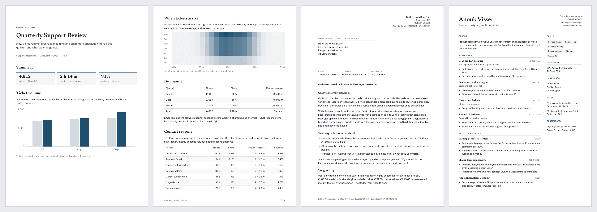

<p align="center">
  
</p>

<h1 align="center">pressroom</h1>

<p align="center">
  A Claude Code plugin that makes Claude a document creator: print-ready HTML and clean PDFs, made on your machine.
</p>

<p align="center">
  <a href="https://github.com/Aethryl/pressroom/actions/workflows/ci.yml"></a>
  
</p>

Ask Claude for a report, a business letter, a quote, a handout, a CV or a cover letter. It writes
the document as one self-contained HTML file with real print CSS, renders it to PDF with headless
Chromium, then looks at every page and fixes cut tables, stranded headings and empty pages before
it hands you both files. It is not a converter: Claude authors and typesets the document, and the
HTML stays as the editable source.



Two report pages, a Dutch business letter and a CV, all from the default theme. The full report is
in [docs/sample-report.pdf](docs/sample-report.pdf).

## Install

```text
/plugin marketplace add Aethryl/pressroom
/plugin install pressroom@pressroom
/reload-plugins
```

Nothing else to run. The skill loads whenever you ask for a document, letter, report, CV,
proposal, quote, handout or a PDF of something.

## Requirements

| Need | Install |
|---|---|
| Python 3.10+ | standard library only |
| Chromium, Chrome or Edge | any installed one, or `npx playwright install chromium` |
| poppler (`pdftoppm`, `pdfinfo`) | Fedora, Debian, Ubuntu: `poppler-utils`; macOS: `brew install poppler` |

The renderer looks for a browser in the Playwright cache, on `PATH` and in the macOS app bundles.
Set `PRESSROOM_CHROME` to use a specific binary.

## Platforms

| Platform | Status |
|---|---|
| Linux | supported, tested in CI |
| macOS | supported |
| Windows | not supported: the renderer drives Chromium over inherited pipe file descriptors, which Windows does not provide. WSL works as Linux. |

## What you get

- Templates for a report, a Dutch business letter (window envelope, kenmerk line, KvK footer), an
  international letter, a quote with line items and totals, a one-pager, a CV and a matching cover
  letter.
- A neutral default look with bundled static fonts (Public Sans, Newsreader, IBM Plex Mono, all
  OFL), embedded in each document so PDFs carry real fonts and render offline.
- Page numbers, running titles and letter footers from CSS `@page` rules, backgrounds kept, no
  browser header or footer.
- A page-by-page review: Claude renders a contact sheet of every page, reads it and fixes layout
  problems before you see the PDF.

## Theming

The look is set by `--pr-*` CSS variables: paper, ink, rules, accent, fonts, type scale, radius
and logo. A theme is one CSS file that overrides them and can add static fonts and a logo as a
`data:` URI. To apply your house style to every document, put the theme in a skill or a CLAUDE.md
and say it is the pressroom document theme. See
[theming.md](plugins/pressroom/skills/pressroom/references/theming.md) for the token table and
[example-theme.css](plugins/pressroom/skills/pressroom/references/example-theme.css) for a
complete theme.

## Development

```text
uv run --with pytest pytest
uvx ruff check . && uvx ruff format --check .
uvx ty check
claude plugin validate .
```

The render test is skipped when no Chromium or poppler is found.

## License

MIT. Bundled fonts are under the SIL Open Font License 1.1; see
`plugins/pressroom/skills/pressroom/references/fonts/`.

Not affiliated with or endorsed by Anthropic. Claude and Claude Code are trademarks of Anthropic.
